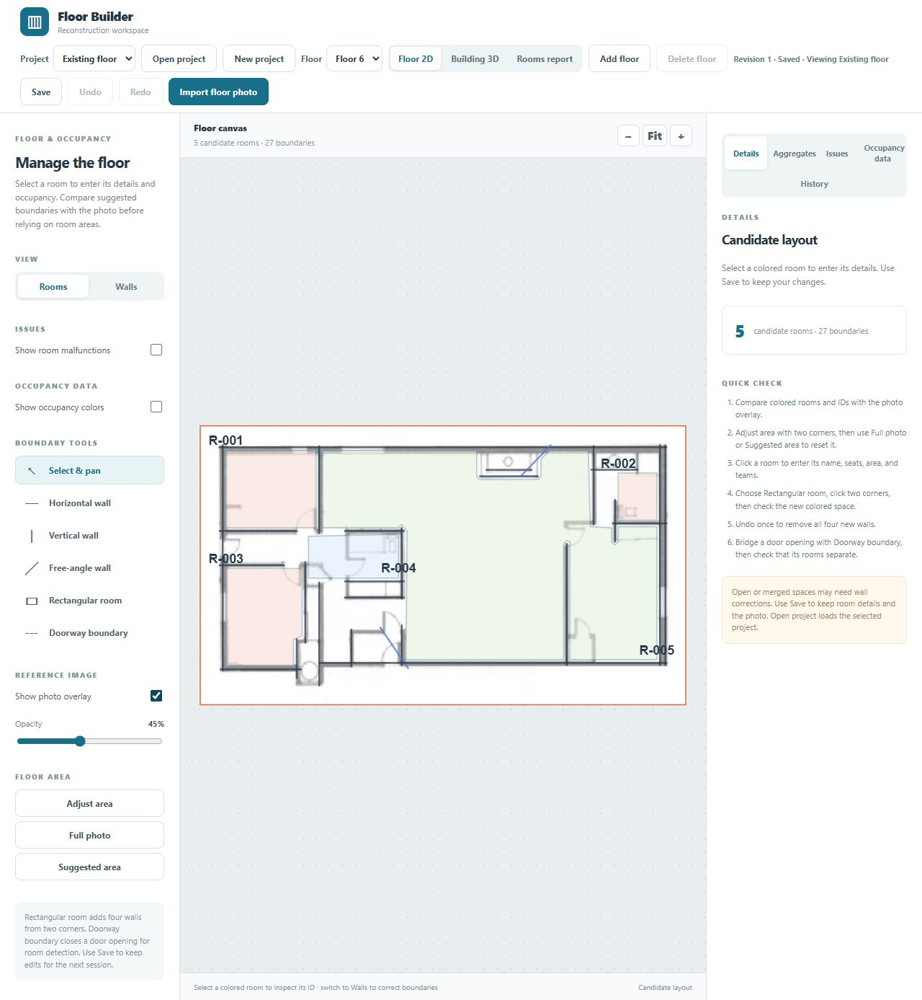
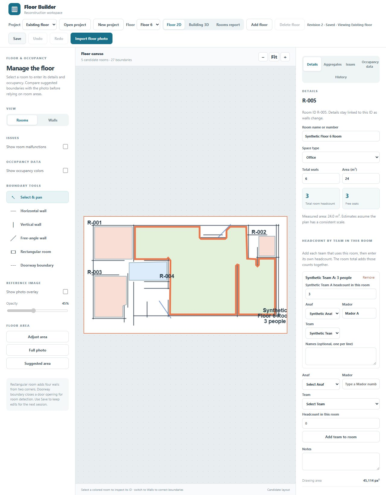
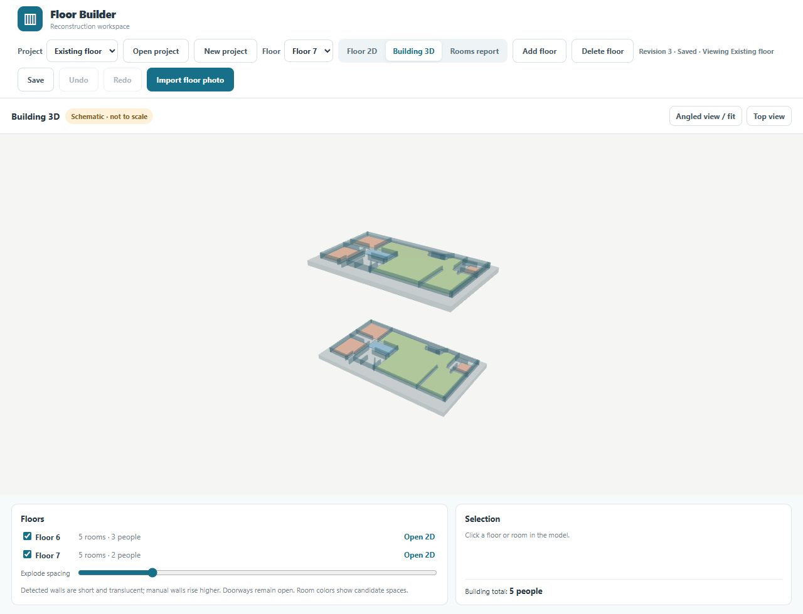
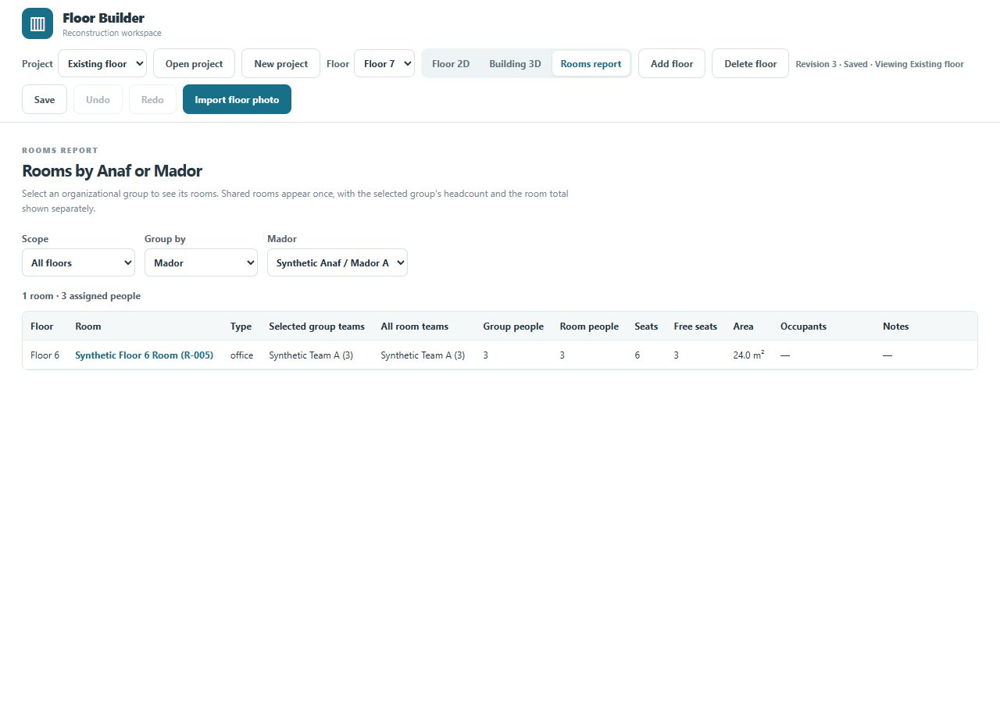

# Floor Builder

Floor Builder turns a floor-plan image into editable rooms and a multi-floor building view. This public repository shows the workflow; the application source and live project data remain private.

## Workflow

1. **Import and review.** Upload a floor-plan image and compare it with suggested walls and rooms. Detection favors longer lines to reduce false walls from labels; draw missing short walls during review.

   

2. **Assign rooms.** Select a room, record its seats and area, and assign teams with headcounts. The room shows its total and free seats.

   

3. **Explore floors.** Add another floor from a plan or copy a layout with empty assignments. A schematic 3D view shows the floors together.

   

4. **Find and review.** Filter the rooms report by Anaf or Mador, open a room from the results, and use saved revisions to recover earlier work.

   

All screenshots use synthetic assignments and a [public-domain demo plan by Ashlynn Schindler](https://commons.wikimedia.org/wiki/File:Floor_plan_1.jpg). Suggested walls and rooms are provisional.
